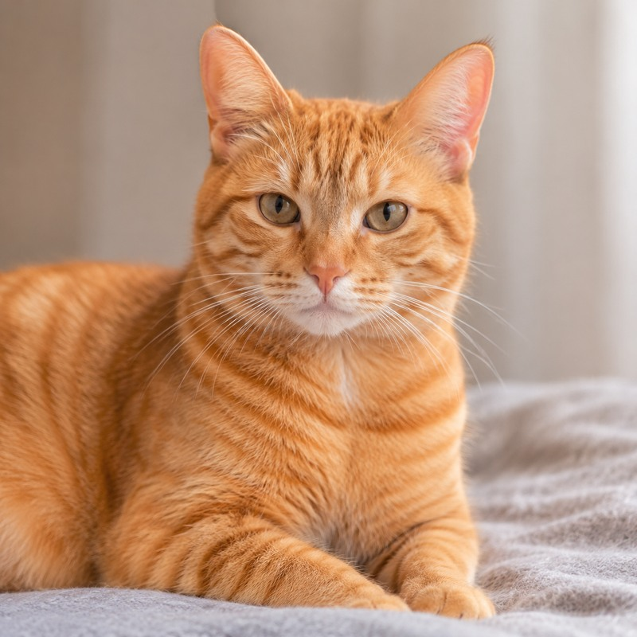
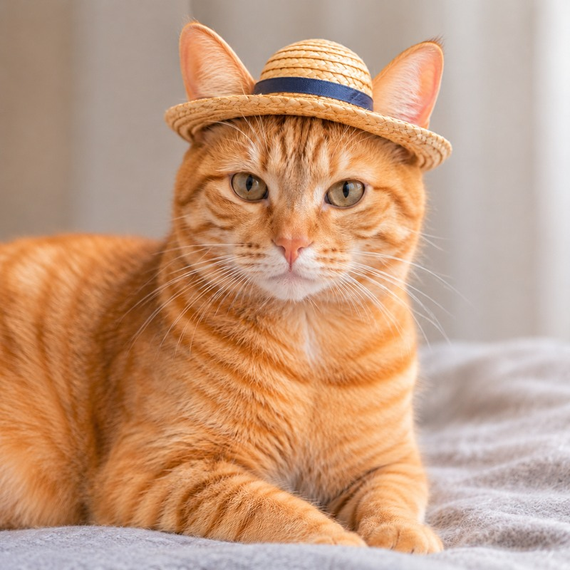

# imagegen-config

给 Codex 的原版 `imagegen` 加一个本地配置入口：使用自己的 OpenAI Images 兼容 API、key 和模型，不设置环境变量，也不修改原版技能。

**一次安装和配置，以后直接说“生成一张……”即可。** 安装时选择 `--set-default`，将这条偏好写入用户级 `AGENTS.md`。只安装技能时，仍可用 `$imagegen-config` 明确调用。

## 效果展示

以下案例使用 `imagegen-config` 调用本地配置的图片 API 制作。图片与 GIF 已压缩，便于在 GitHub 上查看。

### 写实橘猫：生成 → 编辑

| 生成：写实橘猫 | 编辑：戴上小草帽 |
| --- | --- |
|  |  |

原始请求：**“生成一个橘猫的图片，写实风格”**；后续编辑：**“给这个小猫戴上帽子”**。编辑继续使用上一张图片，保留橘猫的样貌、姿势和背景。

<details>
<summary>橘猫生成：完整提示词</summary>

```text
Use case: photorealistic-natural
Asset type: standalone square photograph
Primary request: A photorealistic photograph of one orange tabby cat.
Subject: A real domestic orange tabby cat with natural striped ginger fur, lifelike eyes, fine whiskers, and anatomically accurate proportions, resting comfortably and looking toward the camera.
Scene/backdrop: A simple quiet indoor setting with a softly blurred neutral background.
Style/medium: Natural professional pet photography, true-to-life fur texture and colors, realistic skin and nose detail, no illustration or CGI appearance.
Composition/framing: Eye-level portrait, the cat is the clear main subject, balanced square framing with both ears fully visible.
Lighting/mood: Soft natural window light, gentle shadows, calm warm atmosphere, subtle depth of field.
Constraints: Exactly one cat. No text, logos, watermark, extra limbs, or artificial-looking fur.
```

[查看提示词文件](examples/prompts/orange-tabby.txt)

</details>

<details>
<summary>戴帽子编辑：完整提示词</summary>

```text
Use case: precise-object-edit
Asset type: photorealistic edited pet portrait
Primary request: Put a small hat on the orange tabby cat in the input photograph.
Input images: Image 1 is the edit target; preserve this exact cat and photograph.
Edit: Add one small, simple, natural straw hat with a narrow brim, resting comfortably on top of the cat's head between its ears. Fit the hat to the head realistically; keep the face and eyes fully visible.
Style/medium: Photorealistic, with believable straw texture, matching perspective, soft window light, and subtle contact shadows where the hat meets the fur.
Constraints: Change only the addition of the hat and its physically necessary local occlusion and contact shadow. Preserve the cat's identity, face, expression, fur markings, eye color, ears, anatomy, pose, paws, body, framing, background, blanket, and original lighting. Keep the original square composition. No other clothing or accessories, no additional objects, no text, logos, or watermark.
```

[查看提示词文件](examples/prompts/orange-tabby-hat.txt)

</details>

### 参考图动画：鲸鱼娘吃白饭

<p align="center">
  
</p>

保留角色的蓝色长发、鲸鱼耳朵、尾巴和女仆装，白底 Q 版，约 7 秒循环：**狂吃 → 腮帮子鼓起 → 满足地拍肚子 → 打嗝吐出小泡泡 → 回到起始姿势**。

这个案例使用用户提供的角色参考图。先生成吃饭姿势，再将该姿势排成 3 × 4 分格模板，与原参考图一起输入，生成 12 个动作关键帧；最后在本地裁切、补帧并合成 GIF，添加移动的热气和泡泡。它展示的是完整制作流程；Images API 返回的是静态图片素材。

<details>
<summary>动画关键帧：最终使用的完整提示词</summary>

这里的第一张输入图是 3 × 4 分格模板，第二张输入图是角色参考图。

```text
EDIT THE ENTIRE FIRST IMAGE. It is a twelve-cell storyboard template, 3 columns and 4 rows. Return the ENTIRE GRID, ALL 12 PANELS TOGETHER in ONE tall sprite-sheet image. Do not return a single character. Do not crop or collapse the grid. Keep 1024x1536 canvas. Second image is the character identity reference.
Keep the same exact DeepSeek blue-haired whale maid chibi girl in every cell, with matching face, bangs, ears, bows, white maid headband, navy frilly dress, whale-logo apron, long blue gradient hair and whale tail. Same character scale, foot baseline and camera in all panels. White background. Remove cell numbers; retain the regular cell layout. Full body visible inside every cell.
Change the twelve identical poses into the following sequential animation keyframes (row-major order):
Row 1: [1 holds steaming big full rice bowl and spoon, eager smile] [2 scoops rice, spoon in bowl] [3 spoon to open mouth, small puffed cheeks].
Row 2: [4 spoon back toward bowl, both cheeks bigger, rice half full] [5 another large bite, spoon at mouth, cheeks bigger still, rice quarter full] [6 spoon down, enormous puffed cheeks and closed lips, bowl almost empty].
Row 3: [7 swallow, cheeks normal and eyes closed, empty bowl] [8 holds empty bowl low in left hand, right palm lifts to belly, satisfied smile] [9 right palm pats belly, eyes closed, very happy, empty bowl low].
Row 4: [10 burps with small O mouth, ONE pale blue bubble at mouth] [11 smile and bubble drifting up right, starts lifting bowl] [12 returns to original full bowl and eager smile like panel 1, bubble gone].
Pure white background in all panels. Keep the original Q-version illustration style, no new characters, no lettering, no speech balloons. IMPORTANT: OUTPUT MUST SHOW ALL TWELVE DIFFERENT POSES IN A 3x4 SHEET, not one pose.
```

[查看提示词文件](examples/prompts/whale-girl-animation.txt)

</details>

## 安装并设为默认

需要 Python 3.10+，以及本机已安装的原版 `imagegen` 技能与附带的 `scripts/image_gen.py`。本项目不分发原版技能源码。

```sh
git clone https://github.com/cyx0215/imagegen-config.git
cd imagegen-config
python -m pip install -r requirements.txt
python scripts/install.py --configure --set-default
```

按提示输入 API Base URL、模型名和 key。URL 可以直接留空；模型默认 `gpt-image-2.6`。key 隐藏输入，只写入本地 `config.json`。

**安装后新开一个 Codex 会话**，直接说：

> 生成一张橘猫的图片，写实风格。

> 给这只猫戴一顶小草帽。

默认安装到 `~/.codex/skills/imagegen-config`；如果已有 `CODEX_HOME`，使用该目录。也可以传 `--codex-home PATH` 指定。安装器不创建或修改环境变量。

重复安装会更新程序文件、保留已有 `config.json`，不会重复添加默认路由。重新配置可再次运行 `--configure`，直接按回车保留已有值。

## 为什么需要“设为默认”

Codex 根据技能名称、描述和会话中的指令选择技能。单独放入一个新技能，不会自动覆盖原版 `imagegen` 的选择。

`--set-default` 在全局指令中加入一个带标记的独立区块，声明：普通位图生成、改图优先用 `imagegen-config`，它再复用原版 `imagegen` 的提示词、执行和验图流程。这也记录了用户对配置 API 路径的长期选择，无需每张图片再确认同一路径。

如果存在非空的 `AGENTS.override.md`，安装器会写入该生效文件；否则写入 `AGENTS.md`。其他内容会保留。用户明确指定其他技能/供应商时，以当次请求为准；项目中的其他指令也可能改变选择。这是模型遵循的默认路由偏好，不是一个能强制拦截所有请求的系统开关。已有会话应新开后再验证。

只安装、不设默认：

```sh
python scripts/install.py --configure
```

撤销默认路由，保留技能与 key：

```sh
python scripts/install.py --unset-default
```

## 配置与兼容性

本地配置格式（仓库只提供空 key 的 `config.example.json`）：

```json
{
  "base_url": "",
  "api_key": "填写在本地",
  "model": "gpt-image-2.6"
}
```

也支持完整填写自定义接口与模型；显式值会优先使用，例如：

```json
{
  "base_url": "https://your-provider.example/v1",
  "api_key": "填写在本地",
  "model": "gpt-image-2"
}
```

- `base_url` 省略或留空时，显式使用 `https://api.openai.com/v1`，不会读取环境变量里的地址。填写时使用供应商实际的 API 前缀，通常包含 `/v1`；不填 `/images/generations` 等完整端点。
- `model` 省略或留空时使用 `gpt-image-2.6`；显式填写其他模型（如 `gpt-image-2`）会保留该值。`api_key` 仍需填写。
- `gpt-image-2.6` 是当前使用的供应商别名，不代表 OpenAI 官方接口一定提供此模型。URL 留空时，需使用官方接口支持的 key 和模型。
- 供应商需要兼容 OpenAI Images 的生成/编辑参数和 `data[].b64_json` 返回格式。只兼容聊天接口、仅返回图片 URL 或要求轮询任务 ID 的服务，不能直接使用。
- 模型名必须通过原版 CLI 的 `gpt-image-*` 校验。供应商自己的同族别名可以配置，但其尺寸、透明背景等能力仍取决于供应商与原版 CLI 的校验。
- 本地曾用供应商别名 `gpt-image-2.6` 验证了单图生成和参考图编辑。这不代表所有供应商或同名模型都兼容。
- key 保存在本地 JSON 文件中，不加密；仓库忽略 `config.json`，安装器也不会复制源目录里的真实配置。
- 重新运行交互配置时，URL 输入 `-` 可清空已有自定义地址；直接按回车保留已有值。
- HTTP 客户端显式使用 config 中的地址和 key；不继承 `OPENAI_API_KEY`、`OPENAI_BASE_URL`、组织/项目或 HTTP 代理设置。需要代理的网络应先适配客户端设置。

## 手动验证与调用

以下示例在安装后的技能目录中执行：

```sh
python scripts/run_imagegen.py --check-config
python scripts/run_imagegen.py generate --prompt "A photorealistic orange tabby cat" --size 1024x1024 --out cat.png --dry-run
python scripts/run_imagegen.py generate --prompt "A photorealistic orange tabby cat" --size 1024x1024 --out cat.png
python scripts/run_imagegen.py edit --image cat.png --prompt "Add a small straw hat; preserve the cat and background" --out cat-hat.png
python scripts/run_imagegen.py generate-batch --input jobs.jsonl --out-dir images
```

`--check-config` 只检查本地字段和原版入口，不访问网络、不显示 key；`--dry-run` 只预览请求。首次真实生成才能验证供应商可用性。

原版技能安装在其他位置时：

```sh
python scripts/run_imagegen.py --imagegen-dir /path/to/original/imagegen generate --prompt "A cat" --out cat.png
```

适配器在独立进程中加载原版脚本，只在内存中绑定客户端工厂、配置检查与默认模型，再调用原版入口。原版文件不写入、不复制。原版内部入口变动可能需要更新适配器；不兼容时会停止。

## 测试

```sh
python -m unittest discover -s tests -p "test_*.py"
python tests/test_runtime.py
```

安装器测试覆盖重复安装、保留 key、默认路由写入/撤销以及全局 override。运行时测试需要默认位置的原版 `imagegen`，仅访问本机模拟服务，覆盖生成、编辑、异步批量、冲突环境隔离以及原版文件未修改。

原版技能和 Codex 的背景说明：[技能文档](https://learn.chatgpt.com/docs/build-skills)、[AGENTS.md 文档](https://developers.openai.com/codex/guides/agents-md/)。
